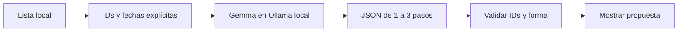

# Modo Tortuga

> **English:** a local first-step planner. Give it up to 30 to-dos and a Gemma model running in Ollama on your laptop picks at most three, each with a first step of 15 minutes or less. Nothing leaves `127.0.0.1`. Built for the [Hacktoberfest Open-Source AI Challenge: Week 3](https://dev.to/challenges/hacktoberfest-week3-2026-10-19).

Un prototipo local para esos días en que una lista de pendientes es demasiado larga para empezar. Lee hasta 30 líneas de texto y le pide a un modelo abierto que elija **hasta tres primeros pasos**. Muestra una propuesta; no cambia tareas, archivos ni calendarios.

Creado durante la ventana del [Hacktoberfest Open-Source AI Challenge: Week 3](https://dev.to/challenges/hacktoberfest-week3-2026-10-19), cuyo tema es *Slow and Steady*.

Código publicado bajo licencia MIT (ver `LICENSE`).

## Probar

Requiere Python 3.10+, [Ollama](https://ollama.com/) y un modelo compatible. No tiene dependencias Python de terceros.

```sh
ollama serve                         # en otra terminal, si no está activo
ollama pull gemma4:e2b               # una sola vez
python3 tortuga.py ejemplo.txt
python3 -m unittest -v test_tortuga.py
```

Un pendiente por línea. Puedes anteponer una fecha **explícita** en formato `[AAAA-MM-DD]`. Las líneas que empiezan con `#` se ignoran. El archivo `ejemplo.txt` es ficticio.

## Cómo funciona



La IA interpreta pendientes escritos de forma libre y propone por dónde empezar; una regla fija comprueba que solo seleccione identificadores existentes. El programa envía la lista únicamente a `127.0.0.1:11434`. El modelo puede sugerir pasos poco útiles o mencionar una fecha equivocada dentro del texto: **la propuesta necesita revisión humana**. No accede a Todoist ni ejecuta las acciones.

Para datos reales, revisa el archivo antes de usarlo. El contenido puede ser sensible y queda en el equipo; el programa no lo guarda después de la ejecución. La descarga inicial del modelo sí necesita Internet.

## Alcance de la demo

El ejemplo permite comprobar el recorrido sin exponer datos personales. No demuestra ahorro de tiempo real; esa medición necesitaría comparar la selección manual con esta herramienta en tareas del mismo tipo.
